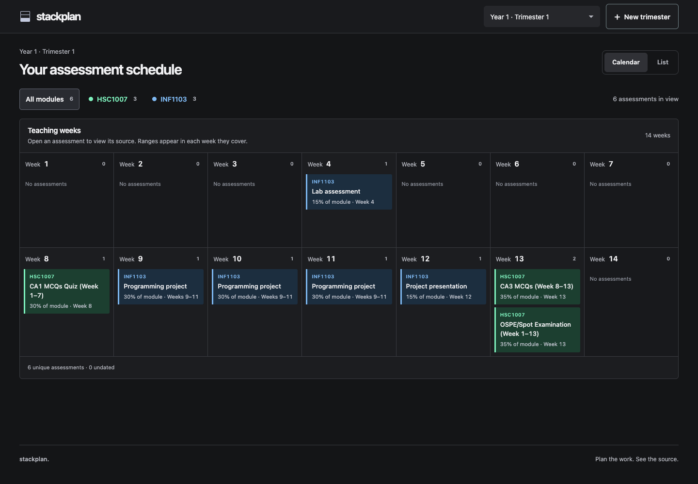
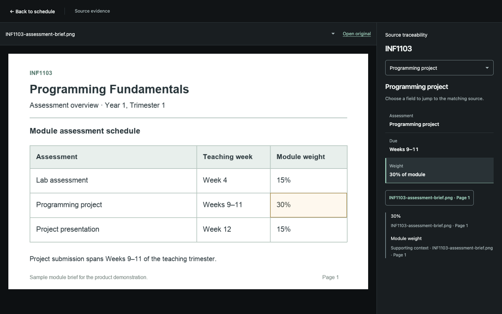
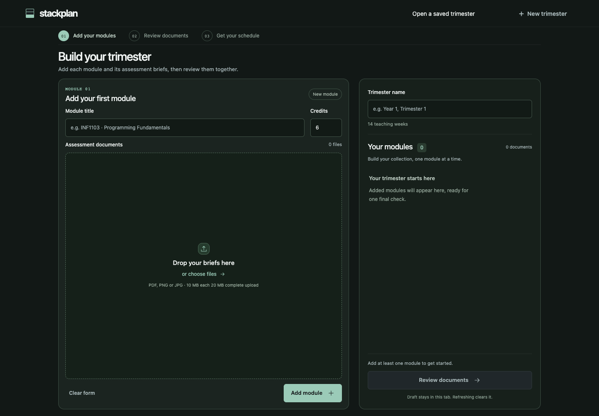
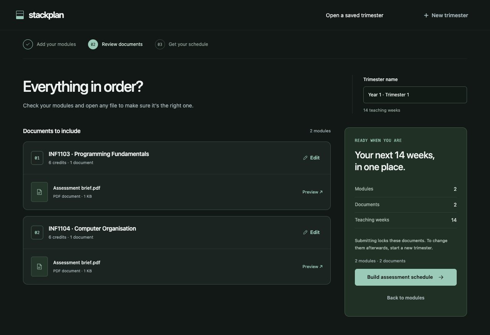
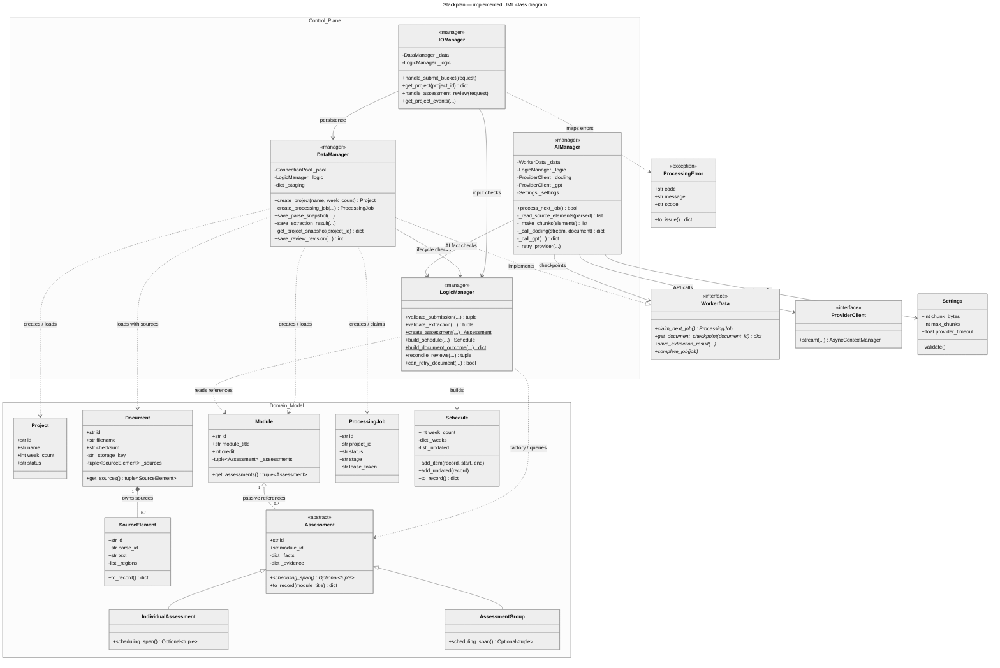

<div align="center">

# Stackplan

**Your assessment calendar. The citations behind it.**

Turn PDFs and images into a weekly schedule, then trace assessment details back to their cited sources.

[Product](#product) | [Setup](#setup) | [Documentation](#documentation)

Python · FastAPI · PostgreSQL · Docling

</div>

---

## Product

### See your trimester at a glance

View deadlines, assessment weights and multi-week projects in one calendar. Filter by module, switch to a list, or open an assessment to inspect its source.



### Click a fact. See its citation.

Open an assessment, then select its **name**, **due week** or **weight** to inspect the evidence behind that detail. Stackplan shows the quoted source text, document name and page number alongside the original document. Image sources highlight the matching region when precise coordinates are available.



*Example: selecting **Weight · 30% of module** highlights the **30%** cell in the sample brief. The citation includes **Page 1** and the supporting **Module weight** header.*

### From documents to deadlines

| 1. Add your modules | 2. Review and build |
| --- | --- |
|  |  |
| Name your trimester and add each module's PDF, PNG or JPG files. | Check your documents, then select **Build assessment schedule**. |

*Screenshots show the current interface with sample data. Click an image to view it at full size.*

- **Verify each cited detail.** Switch between assessment name, due week and weight to inspect the evidence for that field.
- **Keep useful results.** Retry failed documents or upload clearer replacements without losing successful work.
- **See what is unknown.** Missing dates and weights remain visible instead of being guessed.

Built for **INF1103 Project Part 2**.

## Setup

### 1. Get the project

Install **Git** and **Docker Desktop**, then open Docker Desktop and leave it running. Docker runs the app and its services; you do not need to install Python or Node.js for this setup.

If you already have this repository, open a terminal in its folder and skip the `git clone` and `cd` commands.

**macOS — Terminal**

```sh
git clone https://github.com/junshenlye/INF1103-P3-Team7-Project2.git
cd INF1103-P3-Team7-Project2
[ -f .env ] || cp .env.example .env
open -e .env
```

**Windows — PowerShell**

```powershell
git clone https://github.com/junshenlye/INF1103-P3-Team7-Project2.git
cd INF1103-P3-Team7-Project2
if (!(Test-Path .env)) { Copy-Item .env.example .env }
notepad .env
```

### 2. Add your API settings

In `.env`, fill in these two values, then save the file:

```dotenv
OPENAI_API_KEY=your-api-key
OPENAI_MODEL=your-model
```

Use a model that supports **strict JSON Schema structured outputs**. Document processing requires an API key and model. Keep your key in `.env`, which is excluded from Git.

If your configuration uses provider-specific settings, a non-empty `GPT_API_KEY` or `GPT_MODEL` overrides the corresponding `OPENAI_*` value. Set `GPT_BASE_URL` to your provider’s OpenAI-compatible API base URL if it differs from the default (`https://api.openai.com/v1`).

### 3. Start Stackplan

Run from the project folder. The command is the same on **Mac and Windows**:

```sh
docker compose up --build --detach
```

Open **[Stackplan → http://127.0.0.1:5173](http://127.0.0.1:5173)**.

The first launch downloads the services and prepares the database. Docling, the document reader, can take several minutes to start.

| Task | Command (Mac & Windows) |
| --- | --- |
| Check service status | `docker compose ps` |
| View recent logs | `docker compose logs --tail=100 app worker docling` |
| Stop the app and keep saved data | `docker compose down` |
| Start again or rebuild after code changes | `docker compose up --build --detach` |

If the page does not open, check that Docker Desktop is running and inspect the service status above. If document processing fails, check your API settings and worker logs. To use another port, set `FRONTEND_PORT` in `.env`, rerun the start command, and open that port instead.

## Documentation

Technical details and development commands are grouped below. Expand the section you need.

<details>
<summary><strong>Using the application</strong></summary>

1. Name a trimester and add modules with their source documents to the browser's submission bucket.
2. Review the documents, then build the assessment schedule.
3. Follow processing progress. The schedule opens once all documents finish processing and final validation completes. If some documents fail, successful results remain available with recovery options for the failed sources.
4. Select an assessment, then choose its name, due week or weight to inspect the field's cited source text, filename, page number and original document. Image previews highlight the matching region when precise coordinates are available; native PDF previews open the cited page alongside the saved source text.
5. For unresolved documents, retry the failed work or supply a clearer replacement.

Project status follows `Created → Processing → Ready | Partial | Failed | Interrupted`. Execution status, understanding, coverage and stale results are tracked separately. Retries reuse saved parses and accepted chunks. Replacements receive a new document identity; original evidence and older results remain available.

</details>

<details>
<summary><strong>Configuration</strong></summary>

| Variable | Purpose / default |
| --- | --- |
| `OPENAI_API_KEY`, `OPENAI_MODEL` | Extraction credentials and model; required for live processing. |
| `GPT_API_KEY`, `GPT_MODEL` | Optional overrides for extraction credentials/model. |
| `GPT_BASE_URL` | Extraction API base URL; defaults to `https://api.openai.com/v1`. |
| `DOCLING_URL` | OCR/document conversion service; defaults to `http://docling:5001`. |
| `FRONTEND_PORT` | Local web port; defaults to `5173`. |
| `DOCUMENT_WORKERS` | Concurrent document consumers; defaults to `3`. |
| `GPT_CONCURRENCY` | Maximum concurrent GPT calls across worker processes; defaults to `2`. |
| `POSTGRES_PASSWORD` | Local database password; see `.env.example`. |

The app exposes authoritative upload/form bounds at `GET /api/limits`. Defaults are 50 MiB per request, 10 MiB per document, 20 modules and 10 documents per module.

`GPT_API_KEY` and `GPT_MODEL` override the corresponding OpenAI settings when set. The launchers `scripts/start.sh` and `scripts/start.ps1` run the same Docker start command. To use an existing Docling service, set `DOCLING_URL` and run `docker compose up --build --detach app worker`. Both the app and worker share the database and original-document volume.

</details>

<details>
<summary><strong>Architecture, UML and OOP principles</strong></summary>

The application has **17 classes**: four managers, nine domain classes and four supporting classes. Only managers coordinate application objects. Entities operate on their own state and never call another entity or a manager.

| Manager | Responsibility |
| --- | --- |
| `IOManager` | HTTP input/output, upload handling, source delivery, responses and progress streaming. |
| `AIManager` | Background document processing, parsing/chunking, provider requests and bounded retries. |
| `LogicManager` | Input/fact/evidence validation, assessment construction, scheduling, reconciliation and lifecycle decisions. No network or storage work. |
| `DataManager` | SQL, original files, staging, claims/leases, checkpoints, publication, snapshots and history. |

IOManager validates input through LogicManager and accepts work through DataManager. AIManager independently claims queued work through the WorkerData interface. IOManager, AIManager and DataManager request pure business decisions from LogicManager; LogicManager does not call back into them. Provider calls run outside database transactions.

### UML class diagram

Each box shows selected attributes and operations. `+` is public; `-` is internal. Italics indicate abstract operations and underlining indicates static operations. Parameters are abbreviated where needed.

Arrows point from a manager to the collaborator it uses. Hollow triangles point to a superclass/interface. Diamonds describe passive grouping or ownership; they do not represent entity-to-entity calls. Module aggregates independently created assessments; Document exclusively owns its source elements. External library types are not additional application classes.



### Source layout

```text
src/
  managers/
    io_manager.py              IOManager
    logic_manager.py           LogicManager
    ai_manager.py              AIManager
    data_manager.py            DataManager
  models/
    projects/
      project.py               Project
      module.py                Module
    documents/
      document.py              Document
      source_element.py        SourceElement
    processing/
      processing_job.py        ProcessingJob
      lifecycle.py             State/stage constants
    assessments/
      assessment.py            Assessment (abstract)
      individual_assessment.py IndividualAssessment
      assessment_group.py      AssessmentGroup
      schedule.py              Schedule
  contracts/
    worker_data.py             WorkerData (ABC implemented by DataManager)
    provider_client.py         ProviderClient (transport Protocol)
  config/
    settings.py                Settings
    limits.py                  Application bounds
  errors/
    processing_error.py        ProcessingError
    error_codes.py             Issue-code vocabulary
    issues.py                  Primitive issue projections
  serialization/
    json_data.py               Strict JSON decoding
  main.py                      Web composition root
  worker.py                    Worker composition root
  migrate.py                   Migration/repair entry point
database/migrations/           Versioned PostgreSQL schema and constraints
frontend/                      Browser pages, styles and API clients
scripts/                       Launchers, verification runner and UML checker
tests/                         Unit, storage, API, recovery, browser and deployment checks
```

Temporary submission, staging, checkpoint and response values are dictionaries owned by their managers. They are not additional application classes. The two classes outside `src/` are test helpers: a fake provider HTTP handler and an entity-isolation probe.

### OOP and SOL principles

- **Encapsulation:** mutable assessment facts, evidence and source geometry are copied at boundaries. Domain identity equality does not inspect peers; passive references are excluded from generated representations.
- **Abstraction, inheritance and polymorphism:** Assessment defines `scheduling_span()`. IndividualAssessment returns its own range/unknown timing; AssessmentGroup excludes its aggregate total. LogicManager uses the same query without subtype-specific scheduling branches.
- **Interfaces:** DataManager explicitly implements the WorkerData ABC; external HTTP clients satisfy ProviderClient.
- **Association, aggregation and composition:** injected manager collaborators; Module–Assessment grouping; exclusive Document–SourceElement ownership validated by DataManager.
- **SRP:** managers separate HTTP, provider processing, business decisions and persistence.
- **OCP:** a new valid assessment subtype can answer the shared query without changing the scheduling loop; factory/input registration may still change.
- **LSP:** both assessment subtypes obey the same span/undated/excluded contract without changing saved facts or requiring different client preconditions.

</details>

<details>
<summary><strong>API and persistence</strong></summary>

The same app serves the browser and API. Endpoint schemas are available at `/openapi.json`.

| Endpoint | Purpose |
| --- | --- |
| `GET /health`, `GET /ready` | Application/database readiness. |
| `POST /api/projects` | Create a project. |
| `POST /api/projects/{id}/process` | Accept a multipart module/document submission with an Idempotency-Key. |
| `GET /api/projects/{id}`, `GET /api/jobs/{id}` | Read committed schedule, coverage and processing state. |
| `GET /api/projects/{id}/events` | Durable progress stream with Last-Event-ID replay. |
| `GET /api/results/{id}` | Inspect a published result and its effective assessment facts. |
| `GET /api/documents/{id}/original`, `GET /api/documents/{id}/trace` | Retrieve original bytes and saved evidence. |
| `POST /api/documents/{id}/retry` | Retry using `expected_generation` and an Idempotency-Key. |
| `POST /api/documents/{id}/replacement` | Replace using raw bytes, X-Filename, Expected-Generation and Idempotency-Key headers. |
| `POST /api/results/{result_id}/assessments/{assessment_id}/reviews` | Append an evidence-backed correction with `expected_revision`. |

PostgreSQL stores immutable parses, accepted chunks, assessment results, reviews, current result heads and progress events. Original files are checksummed and stored separately under DataManager. Seven migrations run before the web app and worker start.

A retry increments its document generation once per request key. Lease recovery obtains a new worker token; stale workers cannot write. Successful siblings remain published. Review/publication conflicts re-read current versions, while replaced evidence can mark a reviewed result stale rather than silently overwrite it. Project responses use one consistent snapshot and event cursor.

</details>

<details>
<summary><strong>Testing and development</strong></summary>

Tests use deterministic Docling/GPT responses and do not require paid API access.

### Backend checks inside Docker

```sh
docker compose --project-name stackplan-oop-check --profile test run --build --rm tests
docker compose --project-name stackplan-oop-check --profile test down --volumes
```

This uses a separate disposable test database. The host-assisted backup/restore test is covered by the full runner below.

### Full verification

Requires Docker, Python 3.9+, Node.js 20+ and Playwright Chromium. Docker and CI use Python 3.12.

**macOS — Terminal**

```sh
python3 -m venv .venv
.venv/bin/python -m pip install -r requirements-dev.txt
npm ci --prefix frontend
cd frontend
npx playwright install chromium
cd ..
.venv/bin/python scripts/check_uml.py
.venv/bin/python scripts/test.py
```

**Windows — PowerShell**

```powershell
py -3 -m venv .venv
.\.venv\Scripts\python.exe -m pip install -r requirements-dev.txt
npm ci --prefix frontend
cd frontend
npx playwright install chromium
cd ..
.\.venv\Scripts\python.exe scripts/check_uml.py
.\.venv\Scripts\python.exe scripts/test.py
```

`BROWSER_EXECUTABLE` can select an installed Chrome browser; `PLAYWRIGHT_MODULE` can select an existing Playwright module.

The runner creates a uniquely named PostgreSQL container and temporary document storage, runs Python/JavaScript/browser checks, then cleans up its own services. It covers schema validation, content/size limits, ownership, schedules, partial publication, retries/replacements, cancellation, stale leases, concurrent reviews, consistent snapshots, original-file recovery and backup/restore.

To retain the synthetic state-transition trace, set `STACKPLAN_TEST_ARTIFACT_DIR=test-results` before running the suite. The trace records actual API/SQL snapshots for `Created → Processing → Partial → Processing → Ready`, including a targeted generation-2 retry with parse reuse. Test artifacts are ignored by Git.

Latest local verification (15 November 2026): **166 Python tests, 8 frontend tests, 10 browser scenarios and 7 Docker startup checks passed**. The standalone Docker test image passed 165 tests; its one host-assisted restore check passed in the full host run.

GitHub Actions checks README's UML against source and runs the isolated suite on pushes and pull requests. Without a configured disposable test database, direct pytest runs skip database tests; use the documented runner for complete verification.

</details>

<details>
<summary><strong>Operational notes</strong></summary>

Closing the browser does not stop an accepted job. Unexpected worker death requeues unfinished work with a fresh fenced lease, up to three recoveries. Provider retries are bounded: invalid extraction receives one corrective retry; transient service failures receive up to three calls. Missing originals retain saved facts/evidence with a scoped warning. The application is intended for local single-user use, and live extraction accuracy depends on the supplied documents and configured providers.

</details>

---

INF1103 · Team 7 · [MIT License](LICENSE)
