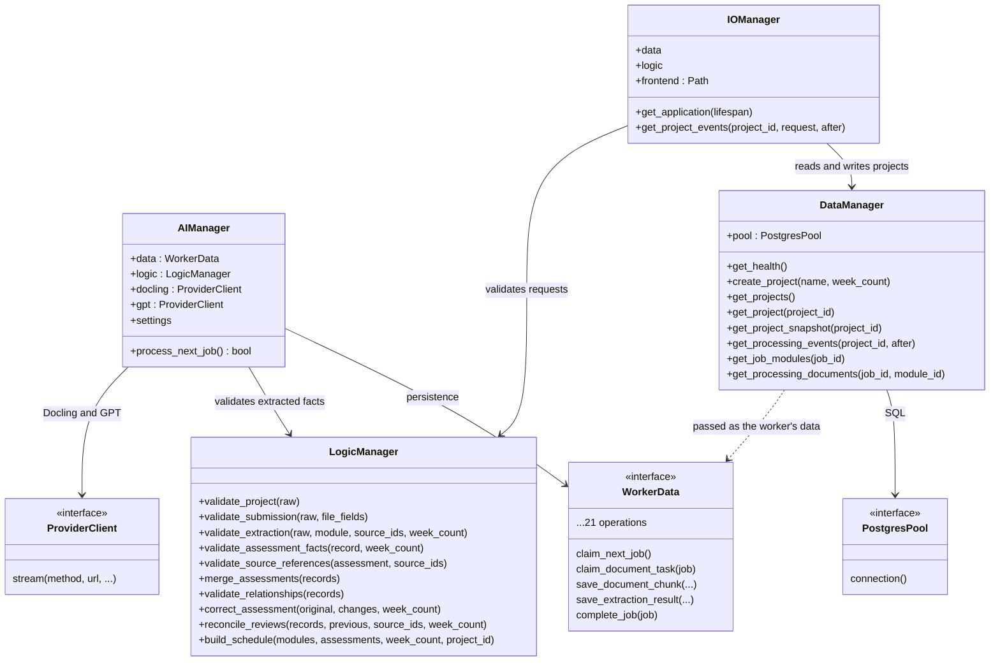
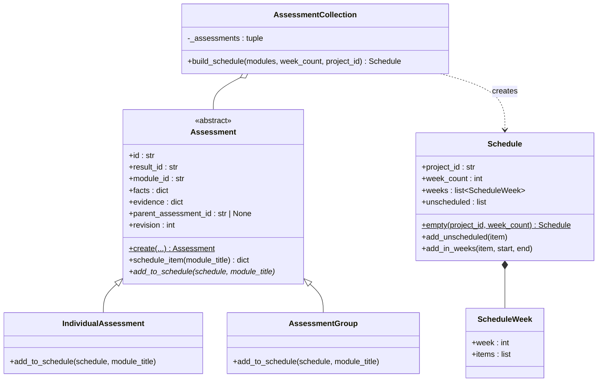
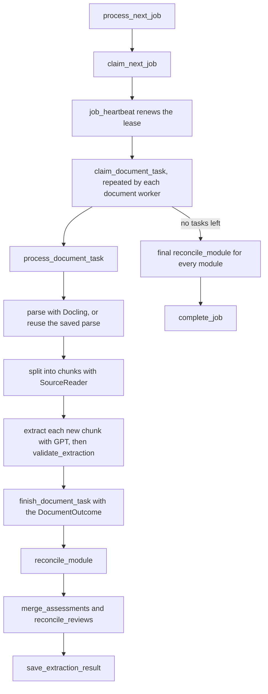

# Architecture

This page describes how the code in `src/` fits together: the processes that run, the four managers and their contracts, the assessment classes behind the schedule, and how one submission is processed. Diagrams use Mermaid, which GitHub renders in place.

## Processes

| Entry point | Starts | Uses |
| --- | --- | --- |
| `src/main.py` (`create_app`) | The web application (served by uvicorn in the `runtime` image) | `IOManager`, `LogicManager`, `DataManager` and a PostgreSQL pool opened for the app's lifespan |
| `src/worker.py` (`run`) | The background worker that processes submissions | `AIManager`, `LogicManager`, `DataManager` and two `httpx` clients (Docling and GPT) |
| `src/migrate.py` (`python -m src.migrate`) | A one-off command that applies `database/migrations/` | `open_postgres_pool` and `apply_migrations` |

In `compose.yaml`, `migrate` runs first. `app` and `worker` start only after it completes successfully.

## Managers and contracts

Each manager owns one responsibility. Infrastructure is passed in through small `typing.Protocol` contracts in `src/contracts/`, so tests can supply in-memory doubles. A concrete class satisfies a protocol by having matching methods; it does not inherit from it.

- **`IOManager`** is the only HTTP boundary. It builds the FastAPI application, turns `ProcessingError` into structured error responses, and streams processing events.
- **`AIManager`** claims one job at a time and runs it to completion. It works through the job's document tasks with a pool of workers, while a heartbeat keeps the job's lease.
- **`LogicManager`** holds every deterministic rule: validation, merging, review reconciliation and schedule building. It has no I/O, clock or provider dependency.
- **`DataManager`** owns SQL for projects, snapshots, events and job inputs. Narrower PostgreSQL adapters in `src/storage/` hold the worker's queue operations (see [Worker storage status](#worker-storage-status)).

## Assessments and the schedule

`Assessment.create` picks the subclass from `facts["kind"]` (`assessment` or `group`). Each subclass places itself:

- **An individual assessment** appears in every week from `week` to `end_week`, or in `unscheduled` when its week is unknown.
- **A group** is a parent total that is kept for validation but never scheduled, because scheduling it would duplicate its children.

`AssessmentCollection` orders assessments by module position, assessment key and id, so the same inputs always produce the same schedule. `LogicManager.build_schedule` turns stored rows into these objects.

## Processing one submission

The helpers in `src/processing/` keep each step small and testable:

| Helper | Role |
| --- | --- |
| `process_document_task` | Parse, chunk, extract and validate one document. It reuses saved parses and accepted chunks. A failed chunk becomes an issue while the other chunks continue. |
| `reconcile_module` | Merge a module's saved records, carry reviewed corrections forward and publish one result. It retries a bounded number of times when a review lands meanwhile. |
| `run_with_retries` | Apply `RetryPolicy` to one provider step: one corrective retry for an invalid extraction, bounded transient retries honouring `Retry-After`, and every failure recorded. |
| `provider_permit` | Hold a shared, database-backed slot so all workers together respect each provider's concurrency limit. |
| `job_heartbeat` | Renew the job lease. If renewal fails, the job's task is cancelled rather than writing results for a lease it may have lost. |
| `convert_document`, `extract_assessment_chunk` | The Docling and GPT calls, with bounded response sizes. |
| `safe_processing_error` | Replace unexpected exceptions with a generic `provider_unavailable` error, so internal details never reach issues or responses. |

Execution and understanding are recorded separately. A document task can *succeed* while its `DocumentOutcome.inference` is `partially_understood`, `unknown` or `no_assessment_content`. Unknown weeks and weights stay `null` with an uncertainty, and are never guessed.

## Dependency rules

- `LogicManager` and `src/models/` use only the standard library.
- Only `IOManager` imports the web framework (FastAPI and Starlette).
- Only `src/storage/` imports the PostgreSQL driver (`psycopg`).
- Only the entry points construct `httpx` clients; everything else receives a `ProviderClient`.
- Issue codes are defined once in `src/errors/error_codes.py` and referenced by name everywhere else.

## Worker storage status

`src/worker.py` passes a `DataManager` to `AIManager` as its `WorkerData`. On `main` (14 November 2026), the 21 operations in `WorkerData` are implemented as follows:

| Implemented by | Operations |
| --- | --- |
| `DataManager` | `get_project`, `get_job_modules`, `get_processing_documents` |
| `PostgresJobLeases` (`src/storage/postgres_job_leases.py`) | `claim_next_job`, `save_job_heartbeat` |
| `PostgresProviderPermits` (`src/storage/postgres_provider_permits.py`) | `acquire_provider_permit`, `release_provider_permit` |
| `PostgresDocumentCheckpoints` (`src/storage/postgres_document_checkpoints.py`) | `get_document_checkpoint` |
| Not implemented yet | `cleanup_interrupted_jobs`, `claim_document_task`, `open_document`, `get_module_checkpoint`, `save_document_progress`, `save_document_checkpoint`, `save_document_chunk`, `record_extraction_attempt`, `finish_document_task`, `save_extraction_result`, `save_module_issue`, `complete_job`, `fail_job` |

The storage adapters are not yet combined into the object the worker receives. Until every operation is available through it, the worker cannot process a submission end to end against PostgreSQL; the processing code is exercised by unit tests with in-memory doubles.
